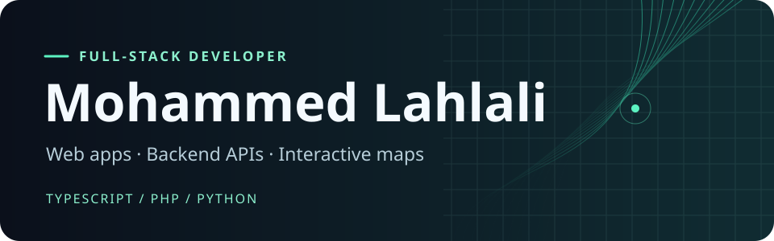

  

  
<strong><a href="https://prfl-amber.vercel.app/">Portfolio</a> · <a href="https://www.linkedin.com/in/mohammed-lahlali-a80996266/">LinkedIn</a> · <a href="mailto:mohmmedlaeh81@gmail.com">Email</a></strong>

  
  
  
  
  
  
  

---

I build web apps and APIs for interactive maps, document processing, and real-time collaboration.

## Selected projects

### 01 · HAB · Geospatial monitoring at Arias Tech Solutions

Built a NestJS endpoint that generates vector tiles for harmful algal bloom detections and integrated the tile layer into an interactive Next.js map. The map supports filtering detections and inspecting individual features.

**Stack** · NestJS, MongoDB, Next.js, Mapbox GL, GeoJSON

### 02 · EZHire · AI-assisted recruitment

Built a recruitment platform with CV screening, background processing, and a Kanban board for tracking candidates through the hiring pipeline.

**Stack** · Next.js, FastAPI, Supabase, Redis, ARQ

### 03 · Chat App · Messaging and video meetings

Built a messaging and meeting app with direct and group conversations, a meeting waiting room, and WebRTC calls. Modeled conversations, member roles, and messages with Prisma and PostgreSQL.

**Stack** · Next.js, NestJS, WebRTC, Prisma, PostgreSQL

---

## Find code you can explore

- **[MapGuesserGame](https://github.com/mohmmedlahlali20/MapGuesserGame)** · A React and Leaflet geography game with timed rounds and distance-based scoring.
- **[Eventoo](https://github.com/mohmmedlahlali20/Eventoo)** · A Laravel event booking app with role-based access for administrators and organizers.
